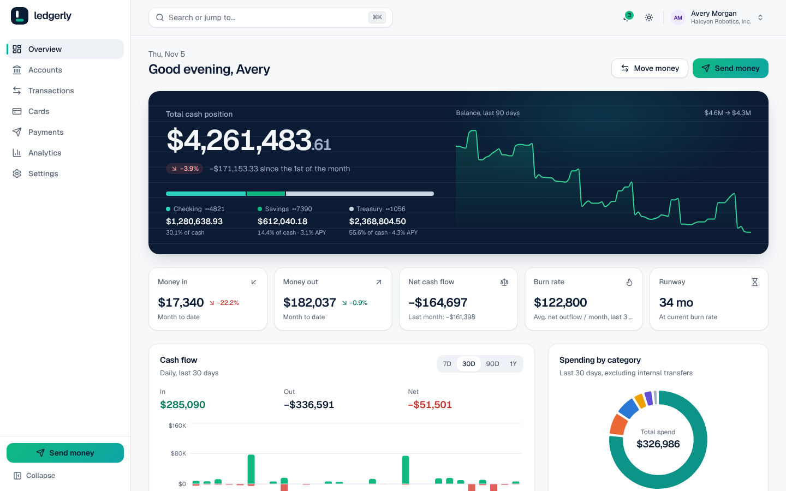
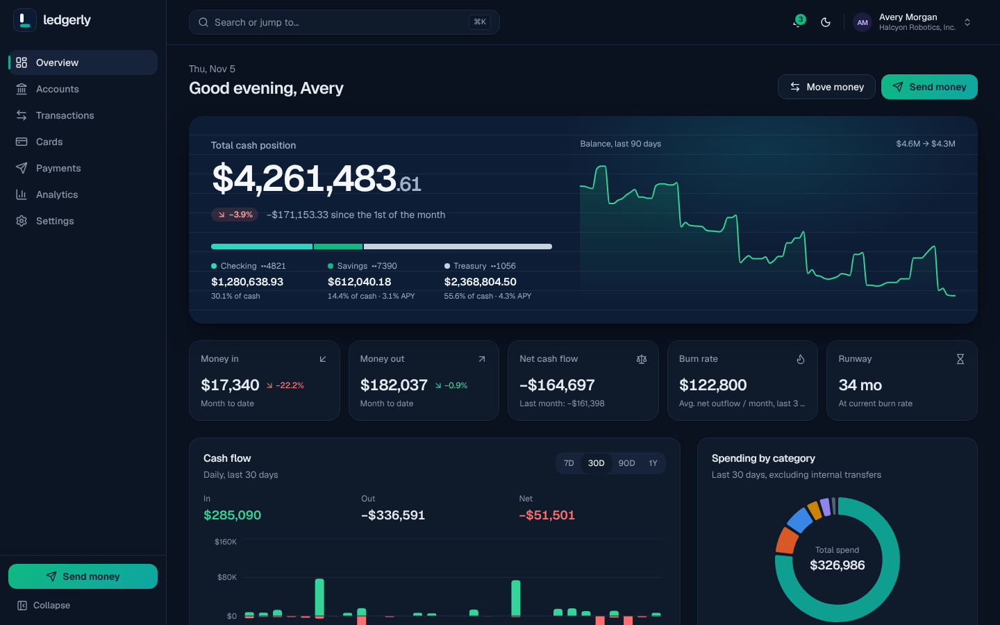
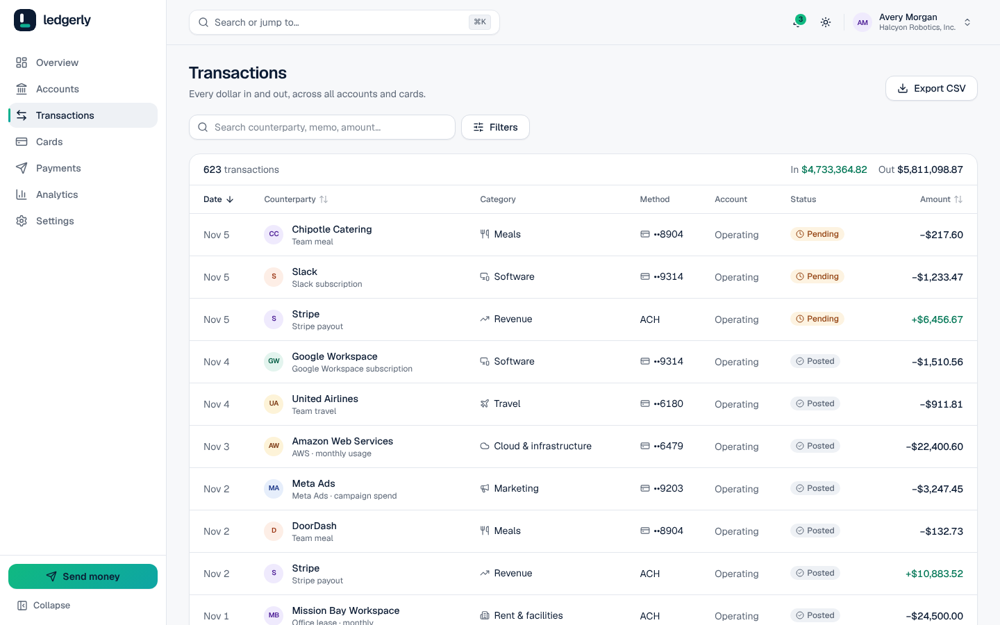
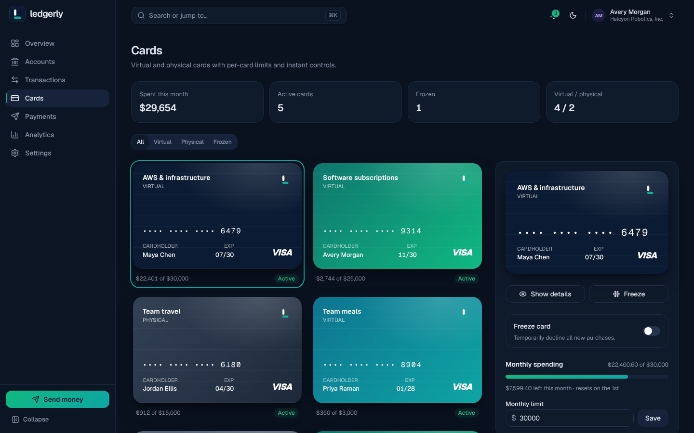
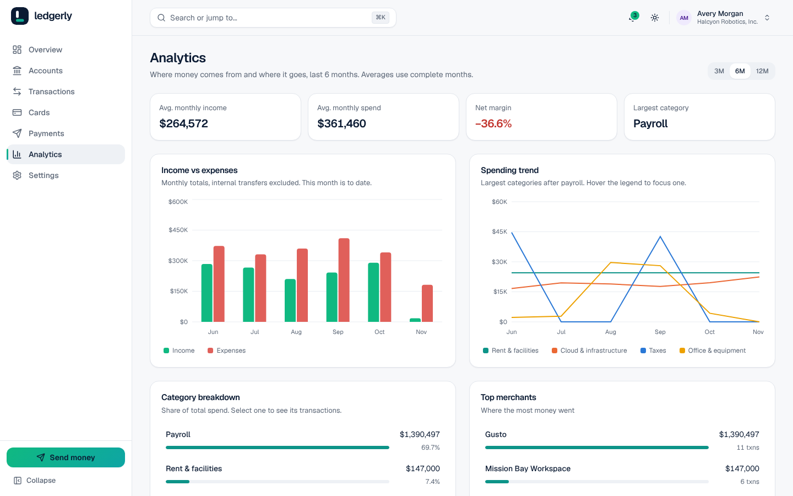
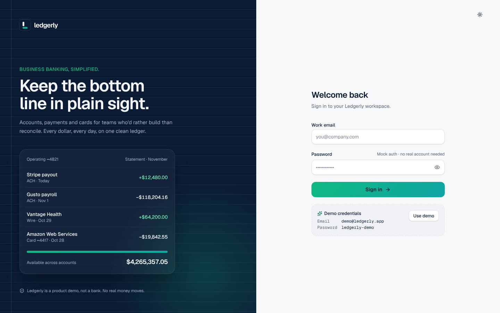

# Ledgerly

**Business banking, simplified.**

Ledgerly is a business banking dashboard built as a technical case study: accounts, transactions, payments, cards and cash-flow analytics for a fictional startup (Halcyon Robotics, Inc.). It runs end to end with a typed mock backend and needs no external services.

> Ledgerly is a product demo. It is not a bank, holds no money and connects to no financial institution.

**Live demo:** https://ledgerly-dashboard-one.vercel.app · **Demo login:** `demo@ledgerly.app` / `ledgerly-demo` (or press **Use demo** on the login page)

| Overview (light)                                              | Overview (dark)                                             |
| ------------------------------------------------------------- | ----------------------------------------------------------- |
|  |  |
|             |                         |
|                   |                         |

## What's in it

- **Mock auth**: login with a signed, HTTP-only session cookie, protected routes, session expiry handling, logout, rate-limited login.
- **App shell**: collapsible sidebar, top bar with a <kbd>⌘K</kbd> command palette (live search over transactions, recipients and cards plus quick actions), notifications, user menu, light and dark themes, a mobile bottom nav.
- **Overview**: total cash position with a 90-day balance trend, per-account split, month-over-month change, money in/out, net cash flow, burn rate and runway, a cash-flow chart (7D/30D/90D/1Y), spending by category with linked hover, recent activity and upcoming payments.
- **Accounts**: balances, available vs. pending, routing details, APY, allocation across accounts and per-account activity.
- **Transactions**: 600+ seeded transactions with debounced search, filters (date, category, status, direction, account, amount), sortable columns, pagination, a detail drawer (timeline, category edit, notes, attachment placeholder) and CSV export. All filter state lives in the URL, so views are shareable.
- **Payments**: a multi-step send flow (ACH, wire, internal transfer, scheduled payments) with Zod validation, balance and rail-limit checks, review and success steps. New transactions appear immediately and balances update. Recipients have full CRUD with ABA routing-number checksum validation.
- **Cards**: virtual and physical cards, freeze/unfreeze, monthly limits, and card details revealed on demand with a 30-second auto-hide.
- **Analytics**: income vs. expenses, category spend trend, category breakdown and top merchants over 3, 6 or 12 months. Every bar links to the matching transactions.
- **Settings**: profile form, mock two-factor toggle and per-channel notification preferences.

## Tech stack, and why

| Choice                                                         | Why                                                                                                                                         |
| -------------------------------------------------------------- | ------------------------------------------------------------------------------------------------------------------------------------------- |
| **Next.js 16 (App Router), React 19, TypeScript strict**       | One deployable unit for UI and API; Route Handlers make a realistic mock backend; `proxy.ts` guards routes before render.                   |
| **Tailwind CSS v4 + shadcn-style primitives (Radix) + lucide** | Owned, accessible components with design tokens as CSS variables, so light and dark are just two token sets.                                |
| **TanStack Query**                                             | Server state with caching, optimistic updates (card freeze, category edits, settings) and explicit invalidation after money moves.          |
| **Zustand**                                                    | Small client-only UI state (sidebar collapse, command palette). Everything else is server state or URL state.                               |
| **Zod + React Hook Form**                                      | One schema per contract, shared by the client forms and the API handlers.                                                                   |
| **Recharts**                                                   | Composable SVG charts with custom tooltips; the categorical palette was validated for colour-vision deficiency and contrast in both themes. |
| **@faker-js/faker (fixed seed)**                               | Deterministic, realistic data: the same seed produces the same ledger every time.                                                           |
| **Vitest + Playwright**                                        | Fast unit tests for the money and business rules; browser smoke tests for the flows that matter.                                            |

## Architecture

```
src/
  app/                 routes: (auth)/login, (app)/* pages, api/* route handlers
  features/<feature>/  api.ts (query hooks), components/, form logic
  components/ui/       design-system primitives
  components/shared/   Amount, MoneyInput, states, chart tooltip…
  lib/contracts/       Zod schemas and types shared by client and server
  lib/domain/          pure business logic: filtering, insights, transfer checks
  lib/money.ts         the only place money is parsed or formatted
  server/              auth, http handler wrapper, in-memory db, repositories, services
```

**Request path:** page → feature hook (`useTransactions`) → `api-client` → Route Handler → `handler()` wrapper (origin check, session, Zod validation, error mapping) → service → repository → per-session store.

### Decisions and trade-offs

- **Money is integer cents everywhere.** Parsing, arithmetic (`sumCents`, `divideCents` with explicit rounding) and formatting live in `src/lib/money.ts`. No floats touch an amount, and all numbers render with tabular numerals.
- **Balances are derived, not stored.** An account's balance is its opening balance plus posted transactions; available balance also subtracts pending outflows. A transfer just inserts transactions, and every view stays consistent.
- **Pending transactions settle lazily.** Each pending transaction has a `settlesAt`; repositories settle it on read. That gives realistic "in flight → posted" behaviour without background jobs.
- **Per-session data.** Each login gets its own copy of the seeded ledger (an LRU of 500 sessions in memory), so visitors to a public demo can't see or break each other's data. The trade-off is that a serverless instance recycle resets data to the seed. For a real persistence layer, swap the repository implementation for Vercel KV or Postgres; services don't change.
- **Shared contracts, shared rules.** `checkTransfer` (balance, rail limits, schedule window) runs in the wizard for instant feedback and again on the server, which is the source of truth.
- **URL as state** for filters, selected transaction, selected card and analytics period: back/forward and links just work.
- **Security for a demo that's still built properly:** HMAC-signed HTTP-only `SameSite=Lax` cookies (`Secure` in production), same-origin checks on mutating requests, Zod validation on every route, text sanitisation, rate-limited constant-time login, CSV formula-injection escaping, strict security headers and CSP, `no-store` on API responses, and no secrets in client bundles. Full card numbers are only returned by an explicit reveal call.
- **Accessibility:** keyboard-reachable everything, visible focus rings, skip link, ARIA labels on icon buttons and charts, live regions for async results, `prefers-reduced-motion` respected, and colour never the only signal (status badges carry text, chart series have legends).

## Run locally

Requires Node.js 20.9+.

```bash
npm install
npm run dev            # http://localhost:3000, log in with the demo account
```

No environment variables are required. See `.env.example` for optional ones (`SESSION_SECRET` is strongly recommended for any shared deployment).

| Script                              | What it does                                                                                          |
| ----------------------------------- | ----------------------------------------------------------------------------------------------------- |
| `npm run check`                     | typecheck, lint and unit tests                                                                        |
| `npm test`                          | Vitest unit tests (money, CSV, filtering, insights, transfer validation, auth tokens, seed, services) |
| `npm run build && npm run test:e2e` | Playwright smoke tests against a production build on port 3100                                        |
| `npm run seed`                      | writes the deterministic seed to `.data/seed.json` for inspection                                     |
| `npm run format`                    | Prettier (with Tailwind class sorting)                                                                |

## Deploy to Vercel

1. Push the repo to GitHub and import it in Vercel (framework preset: Next.js; no build settings to change).
2. Add `SESSION_SECRET` (e.g. `openssl rand -base64 48`) and, optionally, `NEXT_PUBLIC_SITE_URL`.
3. Deploy. There are no databases or third-party services to provision.

## What's next

- Persist sessions' data in Vercel KV or Postgres behind the existing repository interface.
- Real multi-user workspaces with roles and payment approval rules.
- Receipt upload and matching for card transactions.
- Accounting sync (export rules per category), statements as PDF.
- Visual regression tests and a broader Playwright suite across mobile viewports.

## AI-assisted development

This project was built with Claude Code working autonomously from a single written brief. How it was used, and how the output was checked:

- **Plan first.** Claude wrote `PLAN.md` (data model, routes, component tree, build order) before any code, then built in vertical slices: tokens, shell and auth; data and API; overview; transactions; payments; cards; accounts, analytics and settings; tests and docs. Each slice is one conventional commit.
- **Verified after every slice.** `tsc --noEmit`, ESLint with zero warnings and the Vitest suite ran after each slice. Failures were fixed at the cause (for example, Next.js 16's Cache Components rejecting `new Date()` in client render led to a `useNow` hook, rather than disabling the feature).
- **Checked in a real browser.** Claude drove the running app with Playwright to take screenshots on desktop and mobile in both themes, and reviewed them for layout, contrast and chart readability. Several design changes came from that review, such as removing a noisy net-flow line, moving decorative rules that crossed the logo, and excluding the partial current month from analytics averages.
- **Flows checked against the API, not just the UI.** The transfer flow was verified by comparing account balances before and after (exact cent deltas), and the e2e suite asserts the same.
- **Chart colours computed, not eyeballed.** The categorical palette was run through a colour-vision-deficiency and contrast validator for both light and dark surfaces.
- **Human judgement still matters** for product decisions the brief left open (seed company, copy tone, which analytics to show); those choices are documented here and in `PLAN.md` so they're easy to review and change.
